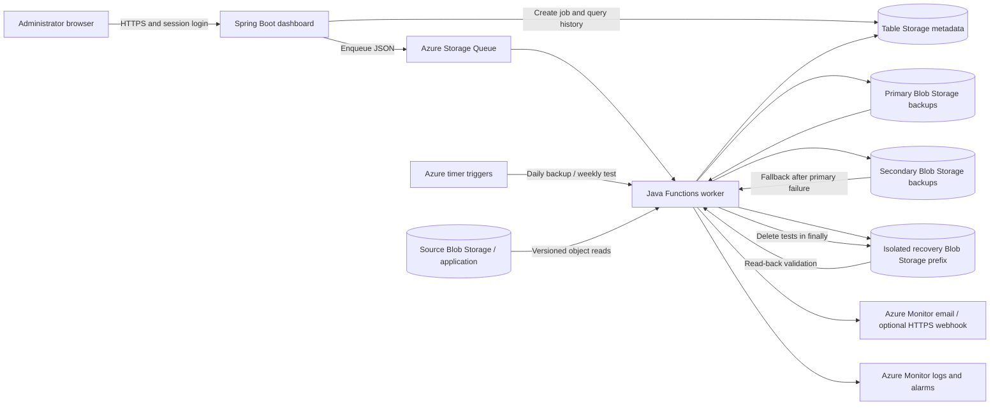
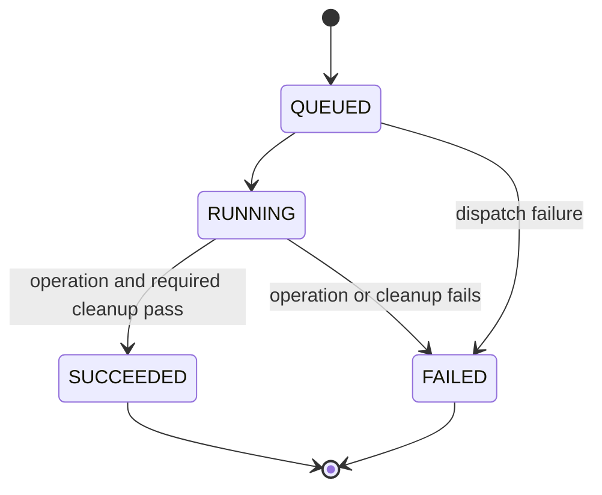

# Architecture and API

## Deployment model



Local mode replaces Blob Storage with four directories, Table Storage with atomic JSON files and Functions with a single Java executor. The engine is shared, allowing failure cases to be tested without cloud cost. It does not emulate Azure role assignments, service outages, geographical separation, network latency or billing.

## Modules and responsibilities

| Module/class | Responsibility |
|---|---|
| `BackupEngine` | Job state transitions, capture, copy, restore, validation, metrics and cleanup |
| `BlobStore` | Object listing, version-aware reads, writes and scoped cleanup |
| `LocalBlobStore` | Disk object-store simulator, path checks and atomic object replacement |
| `AzureBlobStore` | Bounded Azure blob reads, captured versions and cleanup |
| `Repository` | Durable backup/job metadata and a worker lease |
| `AzureTableRepository` | Table entities, reverse chronological row keys and conditional ETag leases |
| `Alerts` | Worker log emission and optional HTTPS webhook delivery; separate notification outcome |
| `RuntimeContext` | Environment-based dependency composition |
| `JobDispatcher` | Local background execution or Azure Queue message dispatch |
| `SecurityConfig` | Session login, BCrypt password hash, CSRF and response headers |
| `Functions` | Functions adapter and deterministic scheduler-event job IDs |

## Backup transaction

1. Acquire the worker lease. Record the job as `RUNNING`.
2. List objects under `application/`; enforce object-count and total-byte limits.
3. Read each source object at its captured version ID. Keep this bounded snapshot in memory.
4. Compute a SHA-256 digest for every object and create a schema-versioned manifest.
5. Write the primary copy and read it back. Write the manifest only after all primary objects verify.
6. Persist a `PRIMARY_ONLY` backup record so a failed replication does not hide a usable backup.
7. Write and verify the secondary copy and manifest. Update backup status to `REPLICATED`.
8. Persist the terminal job status and send an alert. Save notification delivery separately.

A replication failure fails the operation and keeps the primary backup visible. The dashboard does not label a one-region copy as replicated. A new manual backup can be attempted after fixing the region.

## Restore transaction

1. Select a particular backup, or the newest backup for a scheduled test.
2. Compare the stored manifest digest against the trusted metadata record.
3. Validate manifest schema, object names, lengths, uniqueness and count/size limits.
4. Read and checksum every primary object. If any step fails, retry the complete snapshot from the secondary region.
5. Restore into `tests/<job-id>/` or `restores/<job-id>/` in the recovery store.
6. Read back every restored object. Check JSON parsing and the sample registration schema and unique IDs.
7. Record elapsed recovery time and compare the current source to the restored snapshot when reachable.
8. For a test, delete the isolated prefix in `finally` and verify it is empty. Manual restores remain available for inspection.

If cleanup fails, the job is `FAILED` even if data verification succeeded. A hard Functions timeout cannot execute `finally`; Azure Monitor reports Functions errors, old interrupted jobs are reconciled by a subsequent worker, and remaining test prefixes must be inspected by the operator.

## Durable state



Account workspaces use `PartitionKey=TENANT-<id>`. The operator demo and account directory use `PartitionKey=CLOUDSHIELD` and row keys `JOB-<reverse-id>`, `BACKUP-<reverse-id>` and `LOCK`. Job and backup payloads are JSON. Queries return up to the newest 500 items to bound the teaching dashboard. Retention of metadata beyond that display limit is unchanged.

The lock has a 960-second lease, longer than the worker's 600-second Functions timeout. Conditional writes prevent concurrent ownership. Queue batch size is one per instance; the Table lease serializes each account across instances. Completed jobs are idempotent on asynchronous redelivery. Scheduled IDs derive from event type and scheduled time; manual IDs contain a timestamp and random suffix.

## Stored object layout

```text
source:    application/{registrations,catalog,settings}.json
primary:   backups/<id>/manifest.json
           backups/<id>/files/application/<object>
secondary: same snapshot layout in another Azure region
recovery:  tests/<job-id>/application/<object>     # temporary
           restores/<job-id>/application/<object>  # retained
```

The recovery account is deliberately unversioned: deleting a test object removes its content rather than creating only a delete marker. Source and backup accounts are versioned.

## Recovery metric definitions

Let `t_start` be the recovery operation's start and `t_verified` the point at which the restored data and sample health checks pass.

- **Observed RTO:** `(t_verified - t_start)` using the monotonic clock. Includes loading backup data, fallback if required, writes and validation. Excludes subsequent source-difference measurement, notification and cleanup.
- **Observed RPO age:** `max(0, job.startedAt - manifest.createdAt)` in seconds. The manifest timestamp is taken before the bounded source capture.
- **Changed objects:** current source keys absent from the backup, or with a different digest.
- **Changed bytes:** full current byte length of those changed objects. This is not exact byte-level or record-level data loss.
- **Deleted objects:** backup keys absent from the current source. Restoring the backup would reintroduce these objects.
- **Unmeasured:** if the source cannot be read, changed-data fields remain `null`. Zero is never substituted for an unavailable measurement.

## API

| Method | Path | Authentication and behavior |
|---|---|---|
| GET | `/health` | Public liveness only; returns `{"status":"UP"}` |
| GET | `/public/mode` | Public demo flag, no infrastructure names or secrets |
| GET | `/api/csrf` | Public CSRF token bound to the browser session |
| POST | `/login` | Username, password and CSRF token; creates authenticated session |
| GET | `/api/overview` | Authenticated dashboard metadata and schedules |
| POST | `/api/jobs` | Authenticated + CSRF; `{type: BACKUP|TEST|RESTORE, backupId?}`; returns 202 |
| GET | `/api/jobs/{id}` | Authenticated job outcome and metrics |
| GET | `/api/sample` | Authenticated current sample application data |
| GET | `/api/sample?restoreJobId=...` | Authenticated successful manual recovery copy |
| POST | `/api/sample/change` | Authenticated + CSRF; queues a sample registration update in the current workspace |
| GET | `/api/report` | Authenticated JSON download of metadata and evidence |
| POST | `/logout` | Invalidates the authenticated session; CSRF required |

The liveness endpoint does not prove Azure permissions or bucket health. A backup followed by a restore test is the end-to-end readiness check.

## Security and operating boundaries

The dashboard supports a password administrator and public Google account creation with private workspaces. It uses server-side sessions, BCrypt for the password account, HTTP-only SameSite cookies, CSRF protection, CSP and clickjacking protection. It binds to loopback by default. The production reverse proxy terminates HTTPS and enables secure cookies. Environment variables contain configuration; managed identities or Azure CLI sign-in provide Azure credentials.

The worker reads and initializes source application prefixes, writes backup prefixes, deletes only recovery prefixes, accesses the application metadata partitions, and writes operational logs. Per-account data is prefixed by tenants/<id>/; the server derives the ID from the verified Google subject. The local operator has project data roles; a future hosted dashboard should have a separate scoped identity. ARM deployment itself requires broader provisioning permissions.

Checksums detect corruption relative to their manifest. They are not proof against an attacker who can replace both data and metadata. This is a bounded academic reference implementation, not a certified backup product or an availability guarantee.

## Public Google accounts

Google OAuth configuration and the account isolation model are documented in [GOOGLE_SIGN_IN.md](GOOGLE_SIGN_IN.md). All backup, restore, job and report operations resolve their workspace from the authenticated identity. SETUP jobs initialize new sample applications; CHANGE jobs add registrations. Scheduled events fan out to account workspaces. Public usage is bounded by registration, operation and snapshot limits.
