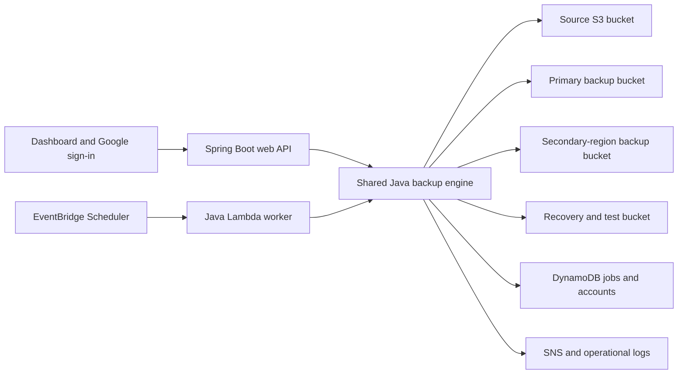

# CLOUDSHIELD: AUTOMATED CLOUD BACKUP AND RECOVERY SYSTEM

**Implementation report · Version 1.0 · 12 November 2026**

GLA University, Mathura

Department of Computer Engineering & Applications

B.Tech Computer Science & Engineering, session 2026–27

Group G360 · VII semester · Project deadline: March 2027

Mentor: **Chitranjan Prasad Sah, Assistant Professor**

| Group member | Section / roll | University roll number |
|---|---|---|
| Bhaskar Kumar | AD-20 | 2315000604 |
| Arpit Singh | AD-65 | 2315000430 |
| Jai Kundu | AC-31 | 2315001005 |
| Yash Pratap Singh Bhadauriya | W-68 | 2315002540 |
| Abhishek Upadhyay | Not specified in synopsis | 2315000079 |

This report describes the implemented application and its observed results. The group should add its actual AWS deployment evidence, institution-required certificate/declaration pages and mentor-approved formatting before submission. No signatures or cloud results are implied.

## Abstract

CloudShield demonstrates automated backup and recovery for a bounded cloud-object application. A Java engine captures timestamped snapshots, records SHA-256 integrity manifests, verifies a second-region copy and performs isolated restore tests. The dashboard exposes recovery time, backup age, changed-object metrics, cleanup outcomes and operational history. Google OpenID Connect creates separate account workspaces. A local adapter permits repeatable classroom demonstrations; the AWS adapter uses S3, DynamoDB, Lambda, EventBridge Scheduler, SNS and CloudWatch. Both adapters use the same backup and recovery logic. Local tests and a live Google sign-in have been completed. The AWS infrastructure configuration has been validated but has not been deployed.

## 1. Problem and objectives

Creating a backup alone does not demonstrate that the application can be recovered. A copy may be incomplete, corrupt, inaccessible or too old for the required recovery point. Manual recovery exercises are also easy to omit, and temporary test data may remain after a failure.

CloudShield addresses these concerns through repeatable backup, verification and reporting. The objectives are to capture identifiable recovery points; retain verified copies in separate AWS regions when deployed; exercise recovery automatically; measure the restore result; clean temporary restore data; and present evidence through a secure web interface. The implemented workload is a synthetic Campus Register application represented by JSON objects, rather than an arbitrary database or virtual machine.

## 2. Scope and requirements

| Requirement | Implemented behavior |
|---|---|
| Java web application | Java 21, Spring Boot 3.5.7, Spring Security and HTML/CSS/JavaScript |
| Daily backup | 02:00 Asia/Kolkata schedule; manual dashboard action |
| Timestamped snapshots | Unique timestamp/UUID backup IDs and manifests |
| Second-region protection | Worker copies and verifies backup objects in a second S3 region |
| Weekly recovery verification | Sunday 02:30 Asia/Kolkata; manual test action |
| Recovery measurements | Restore/verification time, backup age and changed/deleted objects |
| Test cleanup | Immediate cleanup in the engine with verification and delayed safety nets |
| Operational alerts | Local event log or AWS SNS; optional HTTPS webhook |
| Public accounts | Google sign-in with private tenant storage and metadata |
| Deployment material | Terraform, Docker, HTTPS reverse proxy, environment examples and runbooks |

Local mode stores the two regional copies in different folders on one computer. It exercises behavior but provides no geographical redundancy. AWS mode is required to demonstrate actual two-region storage.

## 3. Architecture

The Maven `core` module defines the storage/repository interfaces, backup engine, integrity validation, sample workload and metrics. The `web` module provides authentication, account onboarding, APIs, schedules for local execution and the dashboard. The `worker` module packages the engine for AWS Lambda. The `infra` directory provisions cloud resources and their policies.

Local implementations replace S3 with bounded directories and DynamoDB with JSON metadata. Synchronized reads and replacements prevent Windows metadata-file races when API polling and the worker run concurrently. A cached repository per tenant ensures both use the same synchronization scope.

See `ARCHITECTURE.md` for the API and data model details.

## 4. Backup and recovery method

### Backup

1. Resolve the authenticated workspace and validate capacity and operation limits.
2. Create an auditable job and obtain the workspace worker lock.
3. Enumerate allowed `application/` objects and enforce object-count and byte limits.
4. Copy the captured objects to a unique snapshot prefix and calculate their SHA-256 digests.
5. Store a versioned manifest describing keys, sizes and digests.
6. Copy and verify the snapshot in the secondary region, then persist the result and alert status.

AWS source reads use captured object version IDs. This avoids reading a newer version of an individual object after enumeration, but it is not an atomic multi-object database snapshot. Applications requiring transactional consistency must quiesce writes or use a database-aware capture mechanism.

### Restore test

The worker loads and validates the selected manifest, recovers the objects to an isolated temporary prefix, checks their bytes/digests and validates the sample application structure. It records timing and data-change measurements. A failed primary read can use the verified secondary copy. Finally, it removes the temporary prefix and checks that it is empty. Exceptions and cleanup failures remain visible in the job result. A hard process kill can delay cleanup until stale-job recovery or lifecycle expiry.

### Manual recovery

A manual restore uses an isolated retained recovery prefix. The dashboard can open the recovered sample data alongside live data. It never silently overwrites the source. The deployment runbook describes verification and promotion to a replacement application. An operator can use `scripts/recover-secondary.py`, including its `--tenant` option, when the primary control plane is unavailable.

## 5. Metrics

| Metric | Meaning and limit |
|---|---|
| RTO | Measured restore plus verification duration for this workload; not an availability SLA |
| RPO age | Age of the selected backup at recovery start; not proof of a guaranteed maximum loss interval |
| Changed objects | Live objects whose hashes differ from the selected recovery point |
| Changed bytes | Whole current-object sizes for changed objects; not a byte-level diff or exact lost-record count |
| Deleted objects | Objects present in the backup but absent from the live source |
| Cleanup result | Whether temporary objects were removed and the prefix was checked |

Small local JSON workloads recover in milliseconds. Such measurements must not be presented as AWS throughput benchmarks or as results for large production data.

## 6. Identity and security

Google authorization uses only `openid`, `profile` and `email`. No Gmail inbox or Drive permission is requested. Spring Security performs the authorization-code/OIDC flow and signed-token validation; application checks require the expected issuer and a verified email. Each workspace ID derives from the issuer and stable Google subject, not an editable email or browser-supplied tenant ID.

An account's objects live under `tenants/<id>/` and its metadata in a separate DynamoDB partition or local namespace. Every authenticated API resolves this scope from its principal. The password administrator has its own demonstration workspace. Infrastructure operators retain administrative access to their deployment.

Sessions use HTTP-only, SameSite=Lax cookies. Lax allows Google's top-level callback to preserve the login state; CSRF tokens still protect mutations. Production HTTPS enables Secure cookies. Other controls include BCrypt for the password account, CSP, clickjacking protection, loopback binding by default, private buckets, encryption, TLS-only bucket policies, scoped IAM roles and bounded jobs. The bundled runtime contains modern TLS support. Credentials are never placed in browser JavaScript or the shared ZIPs.

## 7. Interface

The dashboard includes Overview, Backups, Recovery Tests, Sample Application, Activity & Alerts and Configuration. It presents persistent results from the API instead of invented metrics. Rounded cards, dark/light themes, hover/focus feedback and smooth transitions support the requested modern design. Theme preference is retained locally and reduced-motion preferences are respected. Empty, loading, failure and successful states are shown explicitly.

The Google account chooser appears when starting a new sign-in. Existing Google sessions may avoid a repeated password challenge. Signing out of CloudShield ends its session without signing the user out of Google.

## 8. Validation and observed results

The final Java suite passed **37 tests**, including backup corruption/fallback, cleanup, capacity boundaries, tenant isolation, API security, Google identity checks and simultaneous metadata reads/writes. The local HTTP smoke suite passed **16 checks**, including the OAuth-compatible session cookie, backup replication, recovery verification, changed data, retained restore and source preservation.

A real Google sign-in on 12 November 2026 selected the owner's account, returned successfully to the dashboard, created a private workspace and an initial backup. A recovery test in that account succeeded with temporary objects cleaned. Sign-out returned to the login page. A second live Google account and a public HTTPS dashboard have not been tested. Automated tenant tests cover two distinct test identities.

The Google OAuth audience is External / In production. The free homepage and privacy policy are published on Google Sites. Google billing and its free trial were not activated. Terraform validation passed with a locally supplied official provider; no AWS apply or live disaster-recovery exercise was performed.

Exact evidence and reproduction commands are in `VALIDATION.md` and `docs/validation/`.

## 9. Deployment and operation

The full Windows package includes compiled JARs and a private Java 21 runtime. `Start-CloudShield.cmd` starts local mode. A source checkout requires JDK 21 and a Maven build. Google login requires OAuth credentials configured separately for each installation; credentials are excluded from Git and shareable archives.

For AWS, build the worker, review/apply Terraform using an authorized AWS account, confirm the SNS subscription, load the generated settings and run the dashboard on an HTTPS host. Register that exact host's Google callback. A permanent dashboard host is separate from the Google Sites information pages. AWS resources and hosting may incur charges. Follow `AWS_DEPLOYMENT.md` for acceptance, monitoring, recovery and controlled teardown.

## 10. Limitations and future work

The current configuration protects a small sample application: defaults permit 100 accounts, 30 manual operations per account per hour, 30 snapshots per workspace, 500 objects and 20 MiB per capture. Retention management is an operator responsibility. The primary-region control plane is not automatically failed over. Object Lock, customer-managed KMS keys, transactional database backups, signed manifest trust roots, durable per-tenant queues, automated retention and broader deployment tests are future extensions.

The implementation is suitable for a working final-year project demonstration and further cloud deployment. It is not evidence that an enterprise disaster-recovery service has been independently audited or deployed.

## References

- Project specification: *CloudShield Synopsis*, supplied by the group.
- Spring Security OAuth2 Login: https://docs.spring.io/spring-security/reference/servlet/oauth2/login/index.html
- Google OpenID Connect: https://developers.google.com/identity/openid-connect/openid-connect
- Amazon S3 documentation: https://docs.aws.amazon.com/s3/
- AWS Lambda Java documentation: https://docs.aws.amazon.com/lambda/latest/dg/lambda-java.html
- EventBridge Scheduler: https://docs.aws.amazon.com/scheduler/
- Terraform AWS provider: https://registry.terraform.io/providers/hashicorp/aws/latest/docs
